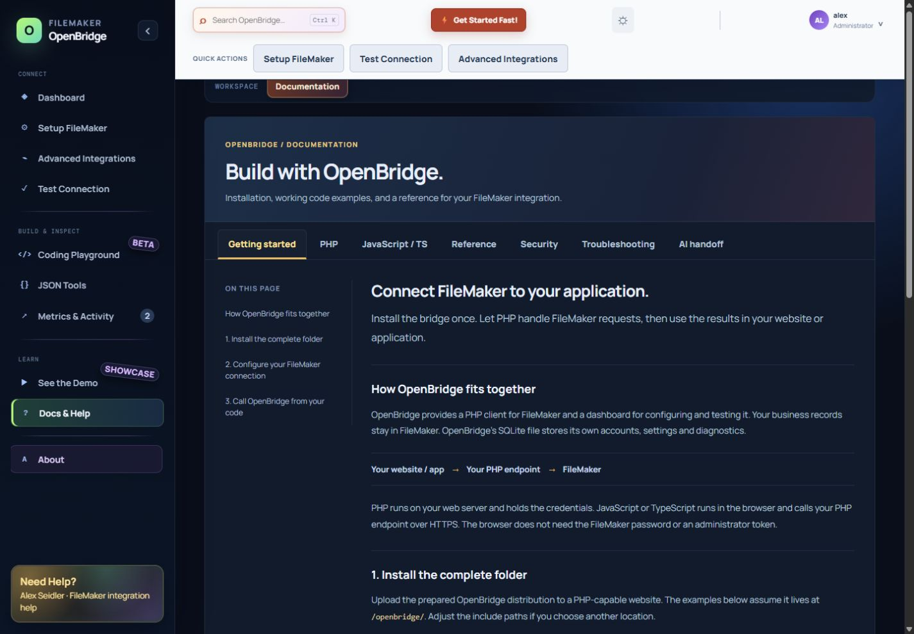

# OpenBridge

**Connect FileMaker to your website with PHP, JavaScript, or TypeScript.**

OpenBridge combines a FileMaker PHP client with a React administration console.
Configure a connection, inspect responses, and build requests without putting
FileMaker credentials into frontend code.

Created by **Alex Seidler · RGC Data**.



## How it works

```text
Your website / React app → Your authenticated PHP endpoint → FileMaker
                                  ↓
                       OpenBridge PHP libraries
```

PHP makes the FileMaker requests and holds the credentials. Browser JavaScript
or TypeScript calls your application's PHP endpoint. OpenBridge's private SQLite
database stores its own accounts, settings, encrypted credentials, and diagnostics;
your business records remain in FileMaker.

## Included

- OData-first dashboard with tabbed FileMaker setup and connection diagnostics.
- PHP `OpenBridge::odata()` and `OpenBridge::dataApi()` factories.
- A consistent response envelope that preserves FileMaker field names and values.
- PHP and JavaScript building blocks in the Coding Playground.
- In-place response inspection, activity summaries, and JSON tools.
- Server-side sessions, encrypted credential storage, and owner-scoped records.
- Tabbed documentation with PHP, JavaScript, and TypeScript examples.
- Unit, mock-FileMaker, SQLite, and local HTTP security tests.

**Status:** development snapshot, package version **1.2.0**. This repository is
source code, not a completed production release. See [known gaps](#known-gaps).

## Run the source locally

Use **Node.js 24**, the pnpm version recorded in `package.json`, and **PHP 8.2+**
with cURL, PDO SQLite, and sodium or OpenSSL.

```sh
git clone https://github.com/alexrgcdata/openbridgev1.git
cd openbridgev1
pnpm install --frozen-lockfile
```

Copy `restCWP/openbridge.config.example.php` to
`restCWP/openbridge.config.php`. In that private copy, set `api.enabled` and
`database.enabled` to `true`. Leave demo-user seeding and optional Go integration
disabled. Keep the private file out of Git.

```sh
pnpm dev
```

Open the exact URL printed by Vite. The development server starts PHP on
`127.0.0.1:8090` and proxies `/openbridge-api.php` to it. If PHP is not on PATH,
set `OPENBRIDGE_PHP_BIN` to its executable path. If you change Vite's hostname or
port, add that exact origin to `api.allowedOrigins` in your private configuration.

Create the first administrator account, configure FileMaker in **Setup FileMaker**,
then use **Test Connection**. Local UI-only fallback access is not proof that PHP
or FileMaker is connected.

## Use the PHP library

For a prepared installation at `/openbridge/`, place this PHP page beside it:

```php
<?php
require_once __DIR__ . '/openbridge/openbridge.php';

$fm = OpenBridge::odata(); // Trusted server-side saved defaults.
$result = $fm->findRecords("Status eq 'Active'", [
    'table' => 'Contacts',
    'queryOptions' => ['top' => 25],
]);

if (!$result['ok']) {
    throw new RuntimeException('FileMaker request failed.');
}
$contacts = $result['records'];
```

For source-checkout usage the same include lives at `openbridge/openbridge.php`.
Explicit trusted configuration overrides are supported. OData uses tables and
filter expressions; the Data API uses layouts and FileMaker find arrays. They
are not interchangeable request formats.

See [PHP and browser integration](docs/using-openbridge-libraries.md) for a complete
authenticated PHP endpoint plus JavaScript and TypeScript callers.

## Use it from JavaScript or TypeScript

Create a narrow PHP endpoint in your own application, then fetch it:

```js
const response = await fetch('/api/contacts.php', {
  credentials: 'same-origin',
  headers: { Accept: 'application/json' },
});
if (!response.ok) throw new Error('Unable to load contacts.');
const result = await response.json();
```

Your application supplies its own authentication and permissions. The OpenBridge
administrator session is for the dashboard. Never embed FileMaker passwords,
administrator tokens, or installation keys in browser code or `VITE_*` variables.
The packaged `openbridge.js` exports browser helpers; importing it does not
authenticate or connect a browser directly to FileMaker.

## Checks

```sh
pnpm lint
pnpm typecheck:tests
pnpm test
pnpm build
pnpm validate:phase2
```

The last command also builds the browser library and runs PHP syntax checks,
temporary SQLite fixtures, mock FileMaker tests, and local HTTP boundary checks.
It requires PHP and creates disposable local test data. These checks do not
require production credentials and do not establish live FileMaker compatibility.

## Build for PHP hosting

```sh
pnpm package:openbridge
```

The command creates the ignored `release/openbridge/` directory with the React
assets, PHP API and libraries, documentation, and a fresh system database.
Upload the **complete folder** to a PHP-capable host and follow the
[installation guide](docs/installation.md). Never upload your development
configuration, keys, or database. GitHub Pages cannot run the PHP backend.

Packaging replaces the generated `release/openbridge/` directory. It does not
deploy anything, and it does not reuse the developer's database or secrets.

## Documentation

- [Getting started](docs/quick-start.md)
- [Installation and configuration](docs/installation.md)
- [PHP, JavaScript, and TypeScript integration](docs/using-openbridge-libraries.md)
- [Method and response reference](docs/api-reference.md)
- [Credential and storage security](docs/security-storage.md)
- [SQLite architecture](docs/architecture-storage.md)
- [Building Playground modules](docs/coding-playground-module-authoring.md)
- [Integration catalog status](docs/integrations.md)
- [Coding-agent reference](OPENBRIDGE-AGENTIC.md)

The dashboard's **Docs & Help** contains the same core usage patterns with
copyable code and an in-page index.

## Known gaps

- Playground workspace persistence helpers exist, but complete save/load/draft UI
  and custom-module editing still need work.
- Generated-code regeneration and safe-test block selection need further work.
- Guided backup/restore, installation-key rotation, and account recovery are incomplete.
- Outside-service catalog entries are planned/research unless explicitly marked available.
- Hosting permissions, protected paths, and live FileMaker behavior need validation
  on each installation. The public source contains no live configuration.

## Contributing and security reports

Read [CONTRIBUTING.md](CONTRIBUTING.md) before changing transport or storage behavior.
For suspected vulnerabilities, follow [SECURITY.md](SECURITY.md); do not publish
credentials or private records in an issue.

## License

[GNU General Public License v3](LICENSE). The existing project license is preserved.
